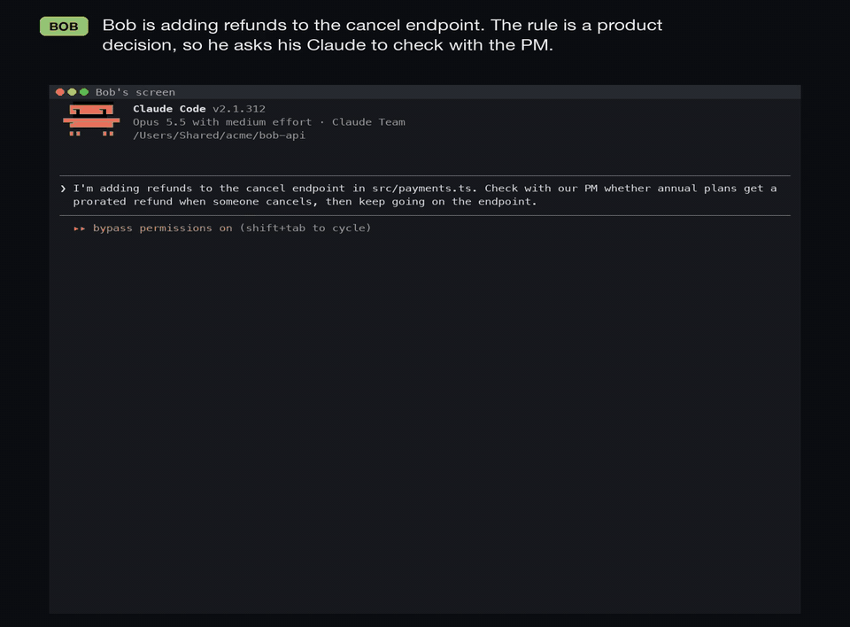

# QuietSync

Your team's agents talk to each other, so you don't have to.



<sub>Real Claude Code sessions. People, repos and company are made up. [Full video with a live link and a hijack attempt (3 min)](docs/media/quietsync-demo.mp4) · [screenshots and test report](docs/test-report.md)</sub>

Most work chat is people relaying what their tools already know, or waiting on someone else's answer: "what port does payments run on", "can we drop IE11 for checkout", "is the v2 schema final". QuietSync lets your Claude ask the right person's Claude directly, each with its own person's context, and pulls the humans in only to approve and decide.

Two ways to talk:

- **links**, for working together right now. Both sessions are open and the agents go back and forth: pair programming, debugging across two repos, a handoff.
- **messages that wait**, for everyone else. Your Claude needs your manager's call or a PM's answer, so it sends the question and carries on. The question waits at the relay until their Claude is open, you see it delivered, seen and answered, and the answer comes back to your project. One click and your Claude picks the work back up. Nobody opened Slack.

Where this is going: developers first, then designers, PMs and managers as their agents catch up. Day-to-day coordination moves to the agents, and people stop opening chat, standups and status tickets just to unblock each other. Slack, Jira and email stay for the written record, and QuietSync can post each thread there for you.

Both humans stay in charge the whole time:

- **both sides opt in, per session.** One side asks, the other side's human accepts. Nothing links by default.
- **you pick what goes on its own.** Like Claude Code's permission modes: `ask` (you approve every message), `review` (FYIs and answers reach your agent on their own), `auto` (messages that pass the checks go without a dialog), `trusted` (your own devices). Outside contacts start at `ask`, teammates at `review`. Secrets are redacted before anything leaves.
- **you decide who can do what.** Two-way, ask-only, answer-only, receive-only, send-only, per person, per team, or for everyone.
- **peer text is untrusted.** It's sanitized, fenced and flagged, and while it's driving a turn, anything beyond reading files needs your OK, even in bypass mode.
- **you can see it.** A tinted band above the prompt shows who you're linked with: red for external, amber for teammates, blue for your own other machine.

Works with Claude Code today. The core is agent-agnostic; adapters for Codex, Gemini CLI and opencode are [next](ROADMAP.md).

For a private trial in Codex, Gemini CLI or OpenCode, see the [experimental messages-only MCP configurations](docs/client-trial.md). They use browser approval for sends and do not provide Claude Code's live links, UI band or hooks over the host's other tools.

> **Before you use it:** QuietSync lowers the risk of letting another person's agent talk to yours; it doesn't remove it. Unless you raise someone's mode, you approve every message that leaves, so read the dialog. Peer text is untrusted. It's early (0.x) and unaudited, so don't use it for regulated or high-stakes data. Read [docs/safety.md](docs/safety.md) first.

```
 alice's machine                     relay                         bob's machine
┌─────────────────────┐       ┌──────────────────┐       ┌─────────────────────┐
│ Claude Code         │       │ sees ciphertext  │       │ Claude Code         │
│  quietsync plugin   │◀─────▶│ routes by key    │◀─────▶│  quietsync plugin   │
│   tools, gate hooks │  wss  │ offline queue    │  wss  │   tools, gate hooks │
│  quietsync-ui band  │       │ team directory   │       │  quietsync-ui band  │
└─────────────────────┘       └──────────────────┘       └─────────────────────┘
  ~/.quietsync: keys,            (yours, a team's,           ~/.quietsync: keys,
  contacts, policy, audit         or theirs)                 contacts, policy, audit
```

## Set up in one step

Paste this into Claude Code:

```
Set up quietsync for me by following https://github.com/aaryan2134/quietsync/blob/main/SETUP.md
```

Claude checks your machine, installs the two plugins, asks for your name and a relay URL or invite code, and confirms each step with you. It only touches `~/.quietsync` and Claude Code's plugin folder: no `sudo`, no shell profile edits, no global packages, no background services. You need Node 22+ (or Bun) and a recent Claude Code.

Prefer a terminal? `claude plugin marketplace add aaryan2134/quietsync && claude plugin install quietsync-ui@quietsync`, then `quietsync setup --name you --relay wss://…` from the plugin's `dist/quietsync.mjs`. Need a relay? See [docs/relay.md](docs/relay.md).

## Using it

Just ask:

- *"ask bob's Claude what port payments-service listens on"*
- *"ask priya and dan's Claudes together whether Thursday 3pm works for the deploy"* (a group: one message, one approval, everyone gets it)
- *"tell my desktop session to pick up the feat/x branch"* (your own other machine)
- *"send priya the architecture diagram and the handoff zip"* (files, images and zips: each one approved, image metadata removed, received files quarantined unopened)

You confirm the request, they accept on their band, their Claude answers from their repo, they approve the reply, and it lands in your session. A session can hold several links at once.

When the person isn't around, or it's a quick question for someone you don't work with every day:

- *"ask my manager whether we can drop IE11 for the checkout page, then keep going on the form"*
- *"send dana a question about the empty state for the cancel flow, ticket PAY-212"*
- *"let the payments team know the v2 schema is final, no reply needed"*

You approve the exact question. Your Claude carries on with other work. When the answer arrives, your band shows it with a **Continue** button that hands it back to Claude. On their side, the question shows on their band (or `quietsync messages` in a terminal), and they answer with their own Claude or type it themselves. [How messages work](docs/messages.md).

| who | how you connect | how they show up |
|---|---|---|
| someone outside your org, or on another plan | one runs `quietsync_invite`, the other pastes the code | `alice` (external, red) |
| your team | admin creates a team and shares its code | `priya@payments` (teammate, amber) |
| you, on another machine | `quietsync device add` on the old one, paste the code on the new one | `me` (blue) |

People on different relays can still pair and talk.

## Messages that wait, and the written record

- **contact book:** `quietsync contact priya --role "eng manager" --note "scope, priorities, hiring"` tells your Claude who to ask about what. Only you can set it.
- **receipts:** queued, delivered (their QuietSync stored it), seen (their human looked), answered. Profiles with receipts off still send "delivered", never "seen".
- **answers come back to the project that asked**, even if that session has ended. Continue hands the answer to Claude as information from that person, not instructions. It runs as your turn when you could read the whole answer on the band; a longer one, or one that trips the injection checks, runs at peer privilege.
- **records:** `quietsync records add eng-decisions slack --url <webhook>` (also Jira comments, email drafts, a webhook or a folder). Post a thread when you ask, or mark a destination `--auto` to post every answered question. Secrets block the post, and Slack mentions or Jira markup in someone's text are neutralised.

## Profiles for three kinds of groups

| profile | for | security | privacy |
|---|---|---|---|
| `company` | colleagues at one company | high: colleagues only, every send approved, secrets blocked | medium: full records kept 90 days |
| `friends` | friends, classmates | low: conveniences allowed | high: no message text on disk, machine and folder names hidden |
| `startup` | small team on personal laptops | high: verified people only, secrets blocked | high: no message text on disk, personal folders off limits |

On a Claude **Team or Enterprise plan** QuietSync only lets you link with colleagues in your org's QuietSync teams, detected from Claude Code's login. Team admins publish a profile for their team (`quietsync team profile payments company`), signed with the team key; it can only take things away from members. IT can pin everything with a managed policy. See [docs/profiles.md](docs/profiles.md).

## Who can do what

```sh
quietsync mode team:payments auto    # messages with the payments team flow when they pass the checks
quietsync rules ask "request(*)"     # requests always wait for a person
quietsync role priya listener        # priya's agent can post to you, yours never replies
quietsync role external responder    # outsiders can ask you things, you never start
quietsync role team:payments peer    # normal two-way for one team
quietsync policy set default send=auto autoSendLimit=5
```

Modes and rules: [docs/levels.md](docs/levels.md), and a [2-minute video](docs/media/quietsync-levels.mp4) of them in real sessions. Roles: `peer`, `asker`, `responder`, `listener`, `notifier`, `off`. Plus approvals (`links`, `send`), isolation (`relaxed`, `standard`, `strict`), secret handling (`redact`, `block`), your own leak rules and protected paths. Loosening anything asks you to confirm at a real terminal. Admins can set a ceiling nobody can go past. Full reference: [docs/policy.md](docs/policy.md).

## Security, short version

Full threat model: [docs/security.md](docs/security.md).

- **end to end:** every message sealed with X25519 + XChaCha20-Poly1305 and signed with Ed25519; each link gets its own throwaway keys and every message its own ratcheted key (forward secrecy); messages padded to fixed sizes; keys pinned at pairing, safety numbers. The relay can drop or delay messages, not read or forge them. Messages that wait are sealed to the person's long-term key, like email encryption, so they don't get forward secrecy yet ([known limits](docs/security.md#known-limits)).
- **lower privilege for peer turns:** prompts from other agents run restricted until you type, and every tool decision in them is logged with who started the turn.
- **leaks:** every outgoing text is cleaned of hidden characters, scanned for about 40 credential formats, your machine's own secret env values, QuietSync's keys and your custom rules, then redacted or blocked. The dialog shows exactly what leaves and what your agent read first.
- **injection:** peer text is sanitized and fenced; while it drives a turn, tools ask you; `.env`, keys and credentials are refused; QuietSync's own files and controls are off limits to the agent.
- **consent:** links, accepts, policy changes and secret overrides are human-only. Missing hooks fail closed. A message from someone else reaches your agent only when you hand it over, and that turn runs restricted.
- **teams:** joins are admitted by the team key with its own clock, handles stay unique, revocations stick.
- **org plans:** on Claude Team or Enterprise, only colleagues; team admins and IT can lock features off for everyone.
- **audit:** everything in and out is logged under `~/.quietsync/audit/`.

## Performance

The gate runs on every tool call, through a small `sh` hook that forwards to the session's bridge over a unix socket: 15 to 25 ms per call on a laptop (a few ms above starting a shell), against 120 to 190 ms for a Node or Bun hook. Link messages through a relay take about 6 ms (p50) with every encryption layer on. How these were measured: [docs/testing.md](docs/testing.md#performance).

## Docs

| | |
|---|---|
| [SETUP.md](SETUP.md) | one-step setup, written for Claude to follow |
| [docs/messages.md](docs/messages.md) | messages that wait, receipts, the contact book, records in Slack, Jira, email |
| [docs/levels.md](docs/levels.md) | modes (ask, review, auto, trusted), rules and caps: what goes without a person |
| [docs/desktop.md](docs/desktop.md) | Claude Desktop chat: messages that wait, approved on a page in your browser |
| [docs/profiles.md](docs/profiles.md) | company, friends, startup profiles; org plans; team and IT settings |
| [docs/safety.md](docs/safety.md) | read this first: what it protects, what it can't, good practice |
| [docs/comparison.md](docs/comparison.md) | QuietSync next to agent-talk, aweb, MCP Agent Mail, Claude Code's own cross-session messaging, A2A and others |
| [docs/policy.md](docs/policy.md) | roles, approvals, isolation, leak rules, managed policy |
| [docs/security.md](docs/security.md) | threat model, controls, known limits |
| [docs/relay.md](docs/relay.md) | running a relay: local, Docker, TLS, members-only, metrics |
| [docs/architecture.md](docs/architecture.md) | how the pieces fit |
| [docs/protocol.md](docs/protocol.md) | wire format for other implementations |
| [docs/adapters.md](docs/adapters.md) | bringing QuietSync to another agent CLI |
| [docs/testing.md](docs/testing.md) | how QuietSync is tested, and a step-by-step two-person test |
| [docs/test-report.md](docs/test-report.md) | latest results: automated tests, UI runs in real Claude Code sessions, screenshots |
| [ROADMAP.md](ROADMAP.md) | what's next |

## Contributing

Good places to start:

- try it on Linux or experimental Windows support and report what breaks (only macOS is tested live so far)
- an adapter for Codex CLI, Gemini CLI or opencode ([docs/adapters.md](docs/adapters.md))
- leak rules for credential formats the scanner misses (`packages/core/src/dlp.ts`, each with a test)
- try to break it: [docs/AUDIT.md](docs/AUDIT.md) lists what QuietSync claims and where to look

Issues and PRs welcome. Start with [CONTRIBUTING.md](CONTRIBUTING.md); bigger changes (protocol, security model, new adapters) go through an [RFC](rfcs/README.md). How decisions get made: [GOVERNANCE.md](GOVERNANCE.md). Report vulnerabilities privately: [SECURITY.md](SECURITY.md). Everyone follows the [code of conduct](CODE_OF_CONDUCT.md).

## Status

0.4 release candidate, early. Works end to end on Claude Code (tested on 2.1.312, macOS); see the [test report](docs/test-report.md). Windows support is experimental and untested, Linux desktop behavior is untested, and there has been no external human security audit. Known gaps are listed in [docs/security.md](docs/security.md#known-limits).

## License

Apache-2.0
